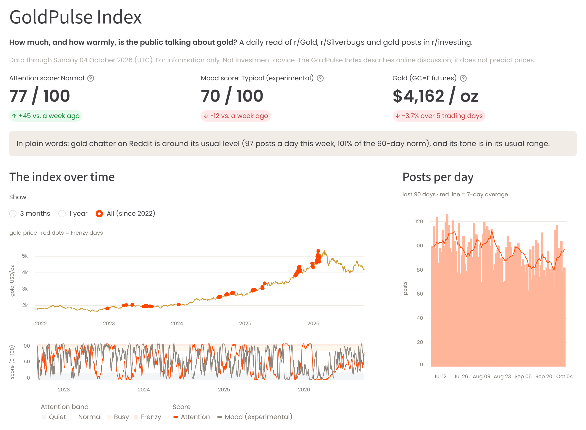

# GoldPulse: Does Reddit Know Where Gold Is Going?



## The project in one paragraph

Many small investors talk about gold on Reddit. We asked whether that conversation predicts the gold price.
We collected posts from r/Gold, r/Silverbugs and gold-related r/investing every 15 minutes, downloaded four
years of history (190,541 posts), scored each post's mood, and tested with supervised models whether mood
helps predict the next hour's and the next day's gold move. **It does not:** no Reddit model beat a model
without Reddit data by more than luck. Granger tests show that gold moves first and the *amount* of Reddit talk
follows it; the *mood* of that talk neither leads nor follows gold, and the pre-set test for unusual activity
before price spikes also failed. We turned that finding into a data product, the **GoldPulse Index**, a daily 0–100 measure of how
much Reddit is talking about gold, shown on a Streamlit dashboard.

## Where to look

| Deliverable | File | Notes |
|---|---|---|
| **Analysis code** | [`notebooks/`](notebooks/) (results) and [`processing/`](processing/) (pipeline) | Start here. Notebooks are saved with their outputs, so they can be read without running anything |
| **Dashboard (the program)** | [`dashboard/app.py`](dashboard/app.py) | How to run it: [below](#run-the-dashboard) |
| **Results tables and figures** | [`reports/exhibits/`](reports/exhibits/), [`reports/figures/`](reports/figures/) | Every number and chart used in the report and poster |

## How the code follows the data science process

| Stage | What we did | Where |
|---|---|---|
| 1. Raw data collected | Reddit posts every 15 minutes (GitHub Actions + Arctic Shift archive); hourly gold prices from Yahoo Finance; four years of history | [`collector/`](collector/), [`price/`](price/), [`.github/workflows/collect.yml`](.github/workflows/collect.yml), [`data/goldpulse.sqlite3`](data/goldpulse.sqlite3) |
| 2. Data processed | Duplicates removed, one row per hour, missing values handled, mood scored (VADER, FinBERT) | [`processing/bucket.py`](processing/bucket.py), [`sentiment/`](sentiment/), notebook [01](notebooks/01_processing.ipynb) |
| 3. Clean dataset | 664-hour table (in [`data/clean/features.parquet`](data/clean/features.parquet)) and a 1,228-day table (1,227 days have a next-day target; built with licensed Bloomberg data, so kept out of the repository) | [`processing/features.py`](processing/features.py), [`processing/daily.py`](processing/daily.py), notebook [02](notebooks/02_features.ipynb) |
| 4. Exploratory data analysis | Summary statistics, histogram, box plot, scatter, outliers | notebooks [03](notebooks/03_eda.ipynb) and [09](notebooks/09_course_checks.ipynb) |
| 5. Models and evaluation | Logistic regression and decision tree vs. simple baselines; time-ordered split and walk-forward testing; confusion matrices, precision/recall/F1 | notebooks [04](notebooks/04_model.ipynb) (hourly), [06](notebooks/06_daily.ipynb) (daily), [09](notebooks/09_course_checks.ipynb) |
| 6. Communicate and decide | Which moves first (Granger tests, event study); report and poster | notebook [08](notebooks/08_report_exhibits.ipynb), [`reports/`](reports/) |
| 7. Data product | GoldPulse Index, rebuilt daily while collection ran; Streamlit dashboard | [`processing/index.py`](processing/index.py), [`.github/workflows/index.yml`](.github/workflows/index.yml), [`dashboard/app.py`](dashboard/app.py) |

### Words used in the notebooks

The notebooks were written while the project ran, so they use the labels from our proposal:

- **H1, H2, H3** are the proposal's hypotheses. **H1:** engagement in an hour is related to the gold move that
  follows it. **H2:** sentiment carries direction (more bullish mood is followed by a rising price). **H3:** a
  model with sentiment beats the same model using price alone. None of the three is supported (notebooks 04, 06 and 09).
- **Phases 1–7** are the proposal's work plan: 1 framing and API setup, 2 live Reddit collection, 3 data
  processing, 4 sentiment scoring and model inputs, 5 models and validation, 6 dashboard and pipeline,
  7 product and report. ("Parts 4–5" and "Parts 6–7" in the pipeline figure refer to these.)
- **"The four proposal plots"** are the four exploratory charts promised in the proposal (notebook 03).

### The notebooks

| Notebook | What it shows |
|---|---|
| [01_processing](notebooks/01_processing.ipynb) | Raw posts and prices → the clean hourly table |
| [02_features](notebooks/02_features.ipynb) | Model inputs, and the check of the mood scorers against 45 hand-labelled posts |
| [03_eda](notebooks/03_eda.ipynb) | The exploratory charts |
| [04_model](notebooks/04_model.ipynb) | Next-hour models (124 test hours), plus the no-r/Silverbugs and FinBERT variants |
| [05_macro](notebooks/05_macro.ipynb) | Variant: posts about inflation, interest rates and the Fed |
| [06_daily](notebooks/06_daily.ipynb) | Next-day models over four years (968 walk-forward test days) |
| [07_bloomberg_extras](notebooks/07_bloomberg_extras.ipynb) | Checks with Bloomberg's spot price and news mood |
| [08_report_exhibits](notebooks/08_report_exhibits.ipynb) | GoldPulse Index chart, event study, trading rules, Granger tests |
| [09_course_checks](notebooks/09_course_checks.ipynb) | Summary statistics, outliers, precision/recall/F1, one-hot and capped re-runs, overfitting, direct test of hypothesis H2 |

## Known limitations

- **Engagement uses settled counts.** Each post's upvotes and comments are the counts measured about 36 hours
  after posting (`config.ENGAGEMENT_SETTLE_SECONDS`). The hourly `log_engagement` input and the H1 lead-lag chart
  therefore use information that was not yet available at that hour. Engagement is not what drove any result,
  and removing it does not turn the null result into a positive one, but read those hourly numbers with this in mind.
- **The hourly sample is small** (307 training and 124 test hours over four weeks), so the hourly results are
  inconclusive rather than proof of no effect. The four-year daily study is the stronger test.
- **`day_of_week` sits in the sentiment feature group**, so the hourly "price + sentiment" models test
  sentiment plus weekday, not sentiment alone.
- **Event study:** the spike threshold is a full-sample 95th percentile, and the 7-day windows of the 24
  events can overlap. See `docs/PITFALLS.md` for every other known issue.

## Run the dashboard

Needs Python 3.10 or newer. From the repository folder:

```bash
pip install -r dashboard/requirements.txt
streamlit run dashboard/app.py
```

It opens at http://localhost:8501. It reads only files already in the repository
(`data/clean/goldpulse_index.parquet` and `data/goldpulse.sqlite3`), so it needs no keys or internet access
apart from the Poppins web font.

## Rebuild the results (optional)

```bash
pip install -r requirements-notebooks.txt     # includes requirements.txt (requirements-finbert.txt adds FinBERT)
python -m unittest discover tests          # 60 offline tests
python notebooks/build.py 02 03 04 05      # re-run the notebooks that use only committed data
python -m processing.index                 # rebuild the GoldPulse Index
```

**Bloomberg data is not included.** It is licensed to us and may not be shared, so notebooks 06, 07, 08 and 09
can be read, with their saved outputs, but not re-run without it.

**Reddit post text is not included.** The published posts tables (`data/clean/history_posts.parquet`,
`data/clean/macro_posts.parquet` and the `posts` table in `data/goldpulse.sqlite3`) keep each post's ID,
time, subreddit, scores and a hash of its normalized text (`text_hash`, used for de-duplication), but not the
text. Everything above rebuilds from that. Re-scoring posts (`sentiment/finbert.py`) or re-running the
backfills needs the text again, which can be fetched by post ID from the Arctic Shift archive. The
hand-labelled samples in `data/validation/` keep the text of their 105 posts so the labels can be checked.

## Repository layout

```
collector/  price/  storage/   collecting posts and prices into the database
processing/  sentiment/        cleaning, mood scoring, model inputs, the GoldPulse Index
notebooks/                     analysis notebooks 01–09 (saved with outputs) and build.py, which re-runs them
dashboard/                     the Streamlit app
reports/                       results tables (exhibits/, model_results.csv) and figures
data/                          database, clean tables, hand-labelled validation samples
tests/                         60 offline unit tests
docs/                          technical guide, product notes, collection log, every problem we hit and fixed
.github/workflows/             the collector and index rebuild (now run by hand), backfills, tests
LICENSE                        MIT, for the code; data and figures come with the limits above
run_*.py  backfill*.py  main.py  config.py   entry points used by the workflows, and settings
```

More detail:
- [`docs/TECHNICAL_GUIDE.md`](docs/TECHNICAL_GUIDE.md): installing, running and rebuilding each part
- [`docs/PRODUCT.md`](docs/PRODUCT.md): how the GoldPulse Index is defined
- [`docs/PITFALLS.md`](docs/PITFALLS.md) and [`docs/COLLECTION_LOG.md`](docs/COLLECTION_LOG.md): every data problem we hit and how it was fixed

## Status

Live collection ran from 8 September to 5 October 2026 and the project has ended, so the scheduled GitHub Actions
jobs are switched off. The index job kept running until 13 November 2026, but it only added
gold prices: the newest index day is 4 October 2026. The data, index and dashboard show the state at the end of the project. Each workflow can
still be started by hand from the Actions tab.

## License

The code is released under the [MIT License](LICENSE). Reddit content belongs to its authors and is not
redistributed here; the derived tables are provided for research and reproducibility only.

## Provenance

A group course project (six students) for the Data Science course in the Financial Engineering programme at
KMITL's School of Engineering. Built with AI coding assistance; design, analysis decisions and
verification by the team.

*For information only. Not investment advice.*
